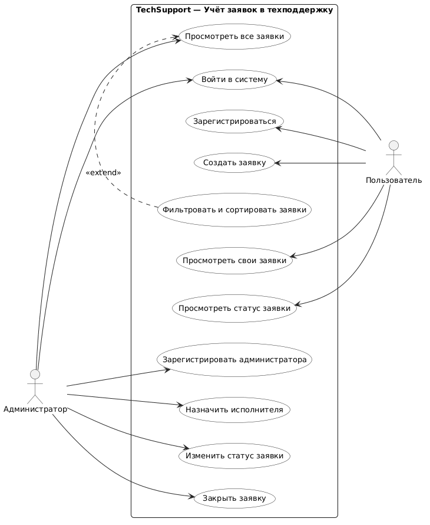
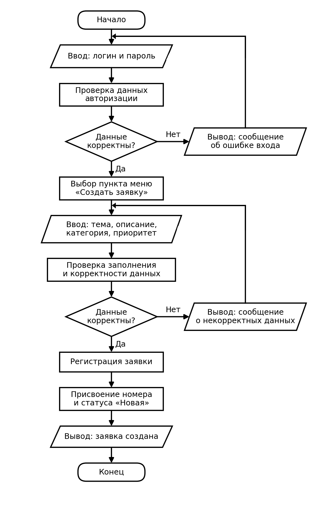

# TechSupport

TechSupport — консольное приложение для автоматизации работы службы технической поддержки. Проект предназначен для регистрации, систематизации и обработки обращений и заявок пользователей.

Приложение позволяет разграничивать доступ по ролям пользователей, выполнять авторизацию и регистрацию, создавать обращения с указанием темы, категории и приоритета, а также контролировать жизненный цикл заявки от создания до её успешного закрытия.

## Возможности

В соответствии с требованиями к системе реализованы и спроектированы следующие возможности:

* самостоятельная регистрация пользователей в системе;
* авторизация пользователей и администраторов;
* создание заявок с указанием темы, описания проблемы, категории и приоритета;
* просмотр пользователем списка своих заявок и отслеживание их текущего статуса;
* просмотр администратором общего реестра поступивших заявок;
* фильтрация и сортировка обращений (отношение расширения `<<extend>>`);
* назначение исполнителя из числа администраторов;
* изменение статусов заявки («Новая», «В работе», «Закрыта»);
* регистрация новых администраторов существующим администратором.

## Моделирование процессов и диаграммы

Проектирование логики работы информационной системы выполнено с использованием языка моделирования **PlantUML** и блок-схем алгоритмов по ГОСТ.

### Диаграмма вариантов использования (Use Case)

На диаграмме представлены два ключевых актора:
* **Администратор** — управляет учётными записями, просматривает все заявки, назначает исполнителей и закрывает обращения;
* **Пользователь** — регистрируется, создаёт заявки и отслеживает их состояния.

Связь между прецедентами *«Фильтровать и сортировать заявки»* и *«Просмотреть все заявки»* оформлена как отношение расширения **`<<extend>>`**, поскольку фильтрация является опциональным действием при просмотре реестра.



Исходный код диаграммы на языке PlantUML находится в файле: [`docs/UseCase.plantuml`](docs/UseCase.plantuml).

### Блок-схема «Создание заявки пользователем»

Отражает пошаговый алгоритм работы пользователя: прохождение авторизации, переход к созданию заявки, заполнение обязательных полей, проверку корректности данных и сохранение обращения. При вводе некорректных данных поток управления возвращается на этап перед блоком ввода.



### Блок-схема «Регистрация пользователя»

Описывает логику создания новой учётной записи пользователя: выбор соответствующего пункта меню, ввод персональных данных (Ф.И.О., логин, пароль), валидацию уникальности логина и успешное создание записи с ролью «Пользователь».


## Структура проекта

```text
TechSupport/
│
├── docs/                       # Проектная документация и модели
│   ├── UseCase.plantuml        # Диаграмма вариантов использования на языке PlantUML
│   └── diagrams/               # Графические схемы и диаграммы
│       ├── UseCase.png         # Use Case диаграмма системы
│       ├── Flowchart_CreateTicket.png # Блок-схема создания заявки
│       └── Flowchart_Registration.png # Блок-схема регистрации пользователя
│
├── src/                        # Исходный код приложения
│   │
│   └── techsupport/            # Основной пакет приложения
│       ├── __init__.py         # Инициализация пакета Python
│       └── main.py             # Точка входа в приложение
│
├── tests/                      # Автоматизированные тесты
│   ├── __init__.py             # Инициализация пакета тестов
│   └── test_main.py            # Модульные тесты приложения
│
├── .gitignore                  # Файл исключений для системы контроля версий Git
├── README.md                   # Основная документация проекта
└── requirements.txt            # Список внешних зависимостей проекта
```

## Архитектура

Приложение спроектировано на основе трёхуровневой многослойной архитектуры:

```text
Пользователь / Администратор
             │
             ▼
Слой пользовательского интерфейса
(src/techsupport/main.py)
             │
             ▼
Слой бизнес-логики
(валидация данных, проверка ролей, жизненный цикл заявки)
             │
             ▼
Слой данных
(хранение сущностей пользователей, заявок, категорий и статусов)
```

Такое разделение изолирует логику отображения от прикладных правил обработки данных, что гарантирует удобство сопровождения и масштабирования системы.

### Основные компоненты

#### `src/techsupport/main.py`

Точка входа в программу. Выполняет запуск приложения и вывод приветственного сообщения.

#### `docs/UseCase.plantuml`

Текстовое описание функциональных прецедентов системы на языке PlantUML, позволяющее версионировать схему вместе с исходным кодом.

#### `tests/test_main.py`

Автоматические тесты на базе стандартной библиотеки `unittest`, проверяющие корректность запуска программы и работы точки входа.

## Требования

Для запуска и сборки проекта необходимы следующие компоненты:

* интерпретатор **Python** версии `3.10` или выше;
* система контроля версий **Git**.

## Установка

### 1. Клонирование репозитория

```bash
git clone <URL-адрес-репозитория>
cd TechSupport
```

### 2. Создание виртуального окружения

```bash
python -m venv .venv
```

### 3. Активация виртуального окружения

Windows PowerShell:

```powershell
.venv\Scripts\Activate.ps1
```

Windows Командная строка (cmd):

```cmd
.venv\Scripts\activate.bat
```

Linux и macOS:

```bash
source .venv/bin/activate
```

### 4. Установка зависимостей

```bash
pip install -r requirements.txt
```

## Запуск приложения

Запуск программы выполняется из корневого каталога проекта:

```bash
python src/techsupport/main.py
```

Или как модуль Python:

```bash
python -m src.techsupport.main
```

Результат выполнения программы:

```text
hello world
```

## Тестирование

Для запуска автоматических модульных тестов выполните команду:

```bash
python -m unittest discover -s tests
```

Результат успешного прохождения тестов:

```text
.
----------------------------------------------------------------------
Ran 1 test in 0.000s

OK
```

## Работа в Visual Studio Code

Для работы с проектом в Visual Studio Code рекомендуется:

1. Выбрать интерпретатор Python из виртуального окружения:
   ```text
   .venv\Scripts\python.exe
   ```
2. Установить расширения среды разработки:
   * **Python** — подсветка синтаксиса и отладка;
   * **PlantUML** — предпросмотр и экспорт диаграмм из `.plantuml`;
   * **Markdown All in One** — предпросмотр документации `README.md`.

## Используемые технологии

* **Python 3** — язык программирования;
* **Git / GitHub** — система контроля версий и удалённый репозиторий;
* **PlantUML** — текстовое моделирование UML-диаграмм;
* **Markdown** — язык разметки технической документации;
* **Visual Studio Code** — среда разработки.

## Разработка

При дальнейшем развитии кодовой базы рекомендуется придерживаться следующей модульной структуры:

* модели предметной области размещать в подпакете `models/`;
* бизнес-логику и сервисы обработки заявок — в `services/`;
* хранение и выборку данных — в `repositories/`;
* консольное меню и интерфейс взаимодействия — отдельно от бизнес-логики.

## Лицензия

Проект является учебным проектом по дисциплине «Информатика».
