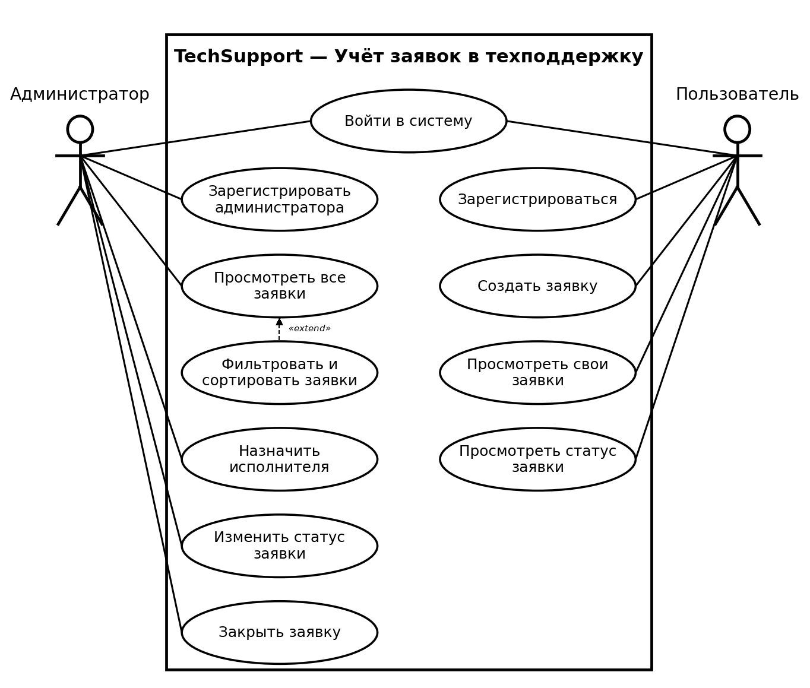
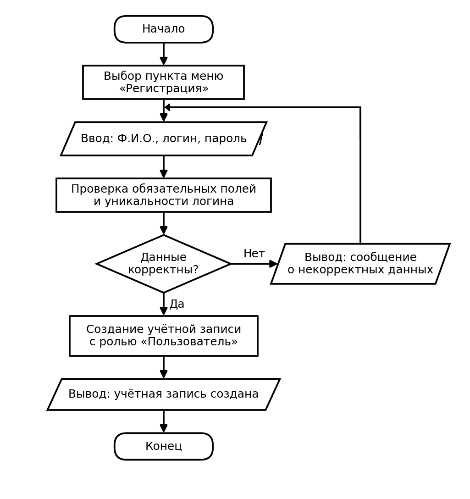
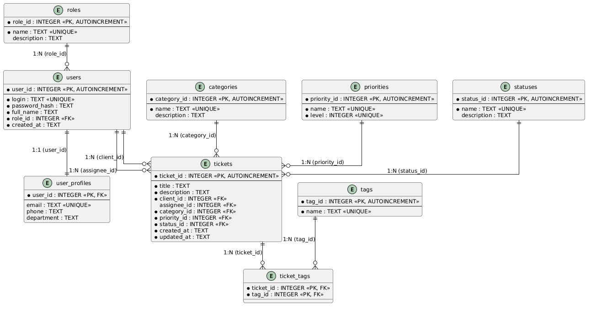

# TechSupport

## О проекте

Проект представляет собой консольное приложение для автоматизации службы технической поддержки («TechSupport»). Система предназначена для регистрации, систематизации и обработки обращений пользователей, а также контроля их жизненного цикла от создания до закрытия.

## Принцип работы системы

Программа построена по трёхуровневой архитектуре:
1. **Слой пользовательского интерфейса** (`src/techsupport/main.py`) — обеспечивает консольное взаимодействие с пользователем.
2. **Слой бизнес-логики** — выполняет валидацию входных данных, авторизацию пользователей и управление статусами заявок.
3. **Слой данных** (`src/techsupport/database/`) — обеспечивает хранение и доступ к данным в реляционной СУБД SQLite.

В системе предусмотрено разграничение прав по ролям:
- **Пользователь** — выполняет самостоятельную регистрацию, авторизацию, создание новых обращений (с указанием темы, категории, приоритета и описания), просмотр реестра своих заявок и отслеживание их статусов.
- **Администратор** — авторизуется в системе, просматривает общий реестр всех поступивших заявок, выполняет фильтрацию и сортировку обращений, назначает ответственных исполнителей, изменяет рабочие статусы («Новая» → «В работе» → «Закрыта») и регистрирует новых администраторов.

## Моделирование системы

### Use Case диаграмма



Исходный код диаграммы на языке PlantUML: [`docs/UseCase.plantuml`](docs/UseCase.plantuml).

### Блок-схемы процессов

#### Создание заявки пользователем


#### Регистрация пользователя



## База данных

Для хранения информации используется реляционная база данных SQLite. Структура данных спроектирована на основе ER-диаграммы и описана в файле `src/techsupport/database/schema.sql`.

### ER-диаграмма



Исходный код диаграммы на языке PlantUML: [`docs/ERD.plantuml`](docs/ERD.plantuml).

### Сущности и связи

1. **Справочники:**
   - `roles` — роли пользователей в системе (`role_id`, `name`, `description`).
   - `categories` — категории обращений (`category_id`, `name`, `description`).
   - `priorities` — приоритеты заявок (`priority_id`, `name`, `level`).
   - `statuses` — возможные статусы заявки (`status_id`, `name`, `description`).
   - `tags` — метки для маркировки заявок (`tag_id`, `name`).

2. **Основные сущности:**
   - `users` — учётные записи пользователей (`user_id`, `login`, `password_hash`, `full_name`, `role_id`).
   - `user_profiles` — расширенный профиль пользователя (`user_id`, `email`, `phone`, `department`). Связь **1:1** с таблицей `users` с каскадным удалением.
   - `tickets` — заявки пользователей (`ticket_id`, `title`, `description`, `client_id`, `assignee_id`, `category_id`, `priority_id`, `status_id`, `created_at`, `updated_at`). Связи **1:N** со справочниками и пользователями.
   - `ticket_tags` — таблица связей многие-ко-многим (**M:N**) между обращениями (`tickets`) и метками (`tags`).

## Структура проекта

```text
TechSupport/
│
├── docs/                       # Схемы и диаграммы проекта
│   ├── ERD.plantuml            # ER-диаграмма (PlantUML)
│   ├── ERD.png                 # Изображение ER-диаграммы
│   ├── Flowchart_CreateTicket.png # Блок-схема создания заявки
│   ├── Flowchart_Registration.png # Блок-схема регистрации пользователя
│   ├── UseCase.plantuml        # Use Case диаграмма (PlantUML)
│   └── UseCase.png             # Изображение Use Case диаграммы
│
├── src/                        # Исходный код приложения
│   ├── __init__.py
│   └── techsupport/            # Основной пакет приложения
│       ├── __init__.py
│       ├── main.py             # Точка входа в приложение
│       │
│       └── database/           # Работа с базой данных
│           ├── __init__.py
│           ├── database.py     # Слой доступа к данным SQLite
│           └── schema.sql      # Схема базы данных и начальные данные
│
├── tests/                      # Автоматизированные тесты
│   ├── __init__.py
│   ├── test_database.py        # Тестирование базы данных и ограничений целостности
│   └── test_main.py            # Тестирование точки входа приложения
│
├── .gitignore                  # Файл исключений для системы контроля версий Git
├── README.md                   # Основная документация проекта
└── requirements.txt            # Список внешних зависимостей проекта
```

## Что нужно для запуска?

- [Git](https://git-scm.com/downloads)
- [Python>=3.10](https://www.python.org/downloads/)

## Запуск проекта

1. Клонирование репозитория:
```bash
git clone https://github.com/kosterik/TechSupport.git
```

2. Переход в корень проекта:
```bash
cd TechSupport
```

3. Создание виртуального окружения:
- **Windows**
```bash
python -m venv venv
```
- **Linux/macOS**
```bash
python3 -m venv venv
```

4. Активация виртуального окружения:
- **Windows**
```bash
venv\Scripts\activate
```
- **Linux/macOS**
```bash
source venv/bin/activate
```

5. Установка зависимостей:
```bash
pip install -r requirements.txt
```

6. Запуск работы:
- **Windows**
```bash
python src/techsupport/main.py
```
- **Linux/macOS**
```bash
python3 src/techsupport/main.py
```

После запуска программа выведет:
```text
hello world
```

## Тестирование

Для запуска автоматических модульных тестов выполните команду:
- **Windows**
```bash
python -m unittest discover -s tests
```
- **Linux/macOS**
```bash
python3 -m unittest discover -s tests
```
